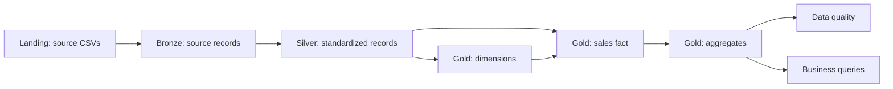

# Beverage Sales Analytics

A PySpark and Delta Lake pipeline for beverage sales analytics. Landing stores original files, Bronze ingests them, Silver standardizes and checks the data, and Gold provides dimensions, a sales fact and aggregates.

## Architecture

The implementation uses Databricks, Spark, Delta Lake and Unity Catalog. Paths and destinations are defined in table configurations.

## Project structure

| Directory | Purpose |
|---|---|
| [configs](configs/README.md) | One JSON per table: locations, descriptions and quality rules |
| [pipelines](pipelines/README.md) | Notebook entry points for each layer |
| [transformations](transformations/README.md) | Ingestion, table transformations and writes |
| [utils](utils/README.md) | Shared configuration, selection, metadata and execution functions |
| [jobs](jobs/README.md) | Versioned orchestration definition |
| [exploration](exploration/README.md) | Source profiling and grain investigation |
| [case_answers](case_answers/README.md) | Business questions answered from Gold |
| [data_quality](data_quality/README.md) | Essential checks and execution history |
| [tests](tests/README.md) | Isolated initial-load, incremental and recovery scenarios |

Notebooks coordinate execution and import reusable Python modules.

## Environment setup

1. Place the project in the workspace, preserving its directory structure.
2. Review the [configurations](configs/README.md). Create configured catalogs, schemas and volumes, with permission to read sources and create or update targets.
3. Place complete CSVs in Landing, following the [Bronze input contract](pipelines/bronze/README.md).
4. Set `project_root` to the absolute project path, such as `/Workspace/Users/<user>/beverage_sales`.
5. Review notebook paths and parameters in the [Job definition](jobs/beverage_sales.json) before deploying to another workspace.

Catalog: `workspace`. Schemas: `beverage_sales_landing`, `beverage_sales_bronze`, `beverage_sales_silver`, `beverage_sales_gold`, `beverage_sales_control` and `beverage_sales_quality`. Silver key registries belong to `control`; quality execution results belong to `quality`.

## Execution and contracts

Run the `beverage_sales` Job for the complete flow. See [Job execution](jobs/README.md) for subsets. Manual execution follows Bronze, Silver, Gold, then data quality; entry points and selectors are described in [pipelines](pipelines/README.md).

- Input files are complete, immutable deliveries with new names.
- Incremental processing supports inserts. Historical updates and deletions require a separate strategy.
- Sales occurrences are preserved; matching attributes do not establish duplicate transactions.
- Keep checkpoints and target tables together during normal operation.
- Use one writer per target. Each target tracks its own progress and can have pending work even when an upstream task reports `NO_NEW_DATA`.
- Exploration, tests and business queries are separate from the production Job.
