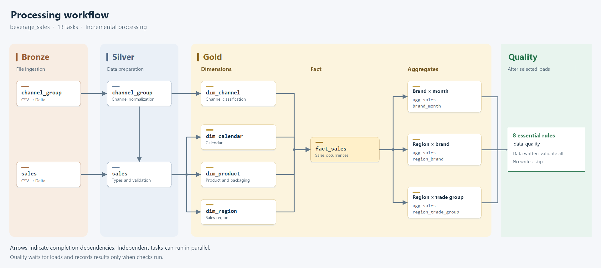

# Job orchestration

The `beverage_sales` Job has one task per table and a final data quality task. [beverage_sales.json](beverage_sales.json) contains its versioned definition.

## Flow



| Stage | Tasks |
|---|---|
| Bronze | `bronze_channel_group`, `bronze_sales` |
| Silver | `silver_channel_group`, `silver_sales` |
| Gold dimensions | `gold_dim_calendar`, `gold_dim_channel`, `gold_dim_product`, `gold_dim_region` |
| Gold fact | `gold_fact_sales` |
| Gold aggregates | `gold_agg_sales_brand_month`, `gold_agg_sales_region_brand`, `gold_agg_sales_region_trade_group` |
| Quality | `data_quality` |

Independent tasks can run in parallel. The fact waits for dimensions; aggregates wait for the fact. The Job uses Serverless, allows one concurrent run, enables queueing and has no schedule configured.

Successful upstream tasks release dependents. `NO_NEW_DATA` is valid: downstream tasks still check for pending work.

## Execution

Open `beverage_sales` in **Jobs & Pipelines** and choose **Run now** for the full flow.

For a subset, use **Run now with different settings**, select tasks and review the graph before starting. Include upstream or downstream tasks when those tables also need updating.

Selecting only `gold_fact_sales` uses existing Silver and dimensions. Selecting an aggregate uses the existing fact. A partial selection changes that run, not the stored definition.

## Parameters

| Parameter | Scope |
|---|---|
| `project_root` | Project path shared by tasks |
| `table_name` | Individual table selected by each load task |

Do not set `table_name` globally: a Job-level value can override task selections. Select tasks for subsets. Manual notebooks also support multiple tables; see [pipelines](../pipelines/README.md).

## Quality and recovery

Each load publishes `has_new_data` through a task value. Quality receives `execution_mode`, `upstream_results` and `run_id` from the Job. If any selected load writes data, quality checks complete configured tables; otherwise it skips without storing results.

Include `data_quality` in partial runs when a full model check is needed. Failures are recorded before the task fails. After correcting the data, run only the [quality notebook](../data_quality/README.md) in Manual mode.

Committed data and checkpoints remain when later tasks fail. Correct the cause and rerun or repair relevant tasks. Do not delete state during normal recovery or run another writer against the same targets.

## Deployment

Review notebook paths, `project_root` and [table locations](../configs/README.md) for the target workspace. With an authenticated Databricks CLI profile, create a missing Job with:

```bash
databricks jobs create --json @jobs/beverage_sales.json --profile YOUR_PROFILE
```

For an existing Job, update its identifier with the JSON as `new_settings` rather than creating another Job. Keep interface changes and the stored JSON synchronized.

A new load needs a task, dependencies and a write indicator in the quality task parameters. Exploration, tests and case answers remain outside this Job.
