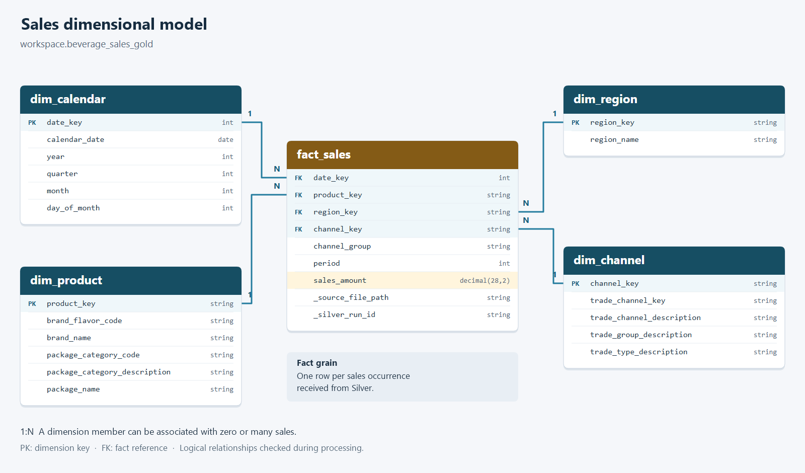

# Gold dimensional model

`01_process_gold` builds four dimensions, a sales fact and three aggregates. Dimensions and fact read Silver; aggregates read the Gold fact and dimensions.

## Model

Each sale references one day, product, region and channel through `date_key`, `product_key`, `region_key` and `channel_key`. A dimension member can have zero or many sales.

| Table | Grain |
|---|---|
| `dim_calendar` | One day, covering complete years found in sales |
| `dim_product` | Brand/flavor, package category and standardized package name |
| `dim_region` | One sales region |
| `dim_channel` | One normalized channel with trade group and type |
| `fact_sales` | One sales occurrence received from Silver |
| `agg_sales_region_trade_group` | Sales total by region and trade group |
| `agg_sales_brand_month` | Sales total by brand, calendar year and month |
| `agg_sales_region_brand` | Sales total by observed region and brand |

All tables reside in the Gold schema configured in [JSON contracts](../../configs/README.md).

## Keys and measures

`date_key` is an integer in `YYYYMMDD` format. Other dimension keys use SHA-256 over business identifiers. Product keys encode their three components as JSON to avoid ambiguous concatenation.

Dimensions insert new members by `MERGE`; existing attributes are not silently changed and SCD type 2 is not implemented. Silver checks conflicting classifications before loading.

The fact preserves all sales occurrences. The source has no unique transaction identifier, so equal attributes are not grounds for deduplication. Package names arrive standardized from Silver.

`sales_amount` is `DECIMAL(28,2)` in the fact and `DECIMAL(38,2)` in aggregates. Negative and zero amounts remain. `period` is the source reporting identifier; year and month come from the date dimension. The sales `channel_group` differs from the channel's trade group.

`_source_file_path` and `_silver_run_id` provide file and execution lineage.

## Execution

Set **Project Root** and **Gold Tables** using the [pipeline pattern](../README.md).

| Selection | Processing |
|---|---|
| `All tables` | All tables in dependency order |
| `dim_product,dim_region` | Only those dimensions |
| `fact_sales` | Only the fact, using existing dimensions |
| An `agg_...` name | Only that aggregate, using existing Gold data |

Unselected dependencies must already be loaded. The first full load follows dimensions, fact, then aggregates. Fact writes check that required dimension members exist.

Each contract uses a matching module in `transformations/gold/tables/`. [processing.py](../../transformations/gold/processing.py) coordinates writes; the [Job](../../jobs/README.md) coordinates table tasks.

## Incremental processing

Each dimension and the fact has an `AvailableNow` stream and `<state_volume>/<table>/checkpoint`. `dim_channel` reads Silver channels; other dimensions and the fact read Silver sales.

Dimension writes insert missing members. Fact writes use a stable `txnAppId` and batch `txnVersion` for replay protection. A source-version marker avoids starting a stream when the source has not changed and a checkpoint exists; checkpoints still track batches.

Aggregates read the complete fact initially. Later runs consume fact insertions through Change Data Feed, add amounts to existing groups and replace the aggregate table. The consumed version is stored in `userMetadata` in the same Delta commit as the totals. Each aggregate tracks its own progress.

Fact updates or deletions are rejected by aggregate processing. Missing required CDF history or a recreated fact requires planned reconstruction.

## Operation

Use one writer per target. Targets do not share a transaction; recovery uses each table's state. No physical partitioning is configured. Aggregate writes replace summary groups, not the fact.

The summary distinguishes new dimension/fact rows from aggregate groups written. Catalog comments come from configuration. [Business queries](../../case_answers/README.md), [incremental tests](../../tests/README.md) and [data quality](../../data_quality/README.md) have separate entry points.
